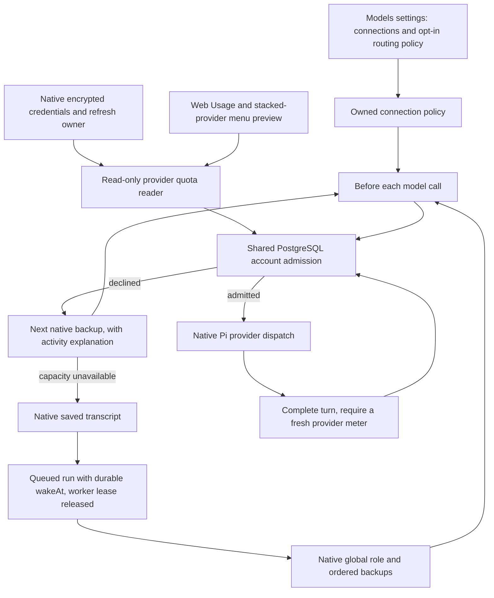

# Observed subscription routing test stack

This fork layers eight commits on upstream main. It keeps native model roles,
ordered fallbacks, account authorization, credential refresh and the run queue.
There is no gateway service or second credential owner.

| Layer | Responsibility | Verification |
| --- | --- | --- |
| 1 | Account-bound Codex and Claude quota readers | Offline provider fixtures and owned-credential API checks |
| 2 | Remaining allowance, reset times and refresh in Usage | Native web browser test, narrow layout and mobile typecheck |
| 3 | Shared PostgreSQL account admission per verified user/provider/account | Concurrent account admission and row-level security |
| 4 | Admission before dispatch, disabled by default | No model request on declined admission, ordinary local errors remain fatal |
| 5 | Skip reason and admitted backup in existing activity stream | Structured runtime events and ordered backup selection |
| 6 | Saved transcript and native queued retry at a model boundary | New runtime resumes after a completed tool, durable wake time and cancellation fencing |
| 7 | Former gateway Usage-account links, retained for rolling compatibility | Existing API and schema remain available during upgrades |
| 8 | Custom usage endpoint and removal of gateway linking controls | Owned endpoint settings, network safety and responsive browser persistence |



## Try the feature

Use the repository's pinned package manager and Node version. Install normally,
generate Prisma, then start the existing development environment:

```sh
corepack pnpm install --frozen-lockfile
corepack pnpm --filter @rakazo/db exec prisma generate
corepack pnpm dev
```

The native dev launcher prints the URL and isolates this branch's additive
migrations from the shared main database. Ensure `pnpm` subprocesses also use
the pinned package manager, for example with `corepack enable pnpm` in a local
Corepack installation. Do not point a development checkout at production data.

In Models, connect a Codex or Claude subscription through native authorization.
On the web, Usage stacks connected providers with their verified quota windows.
Account menu > Usage opens a compact popover; View usage opens the full page.
Unavailable quota is explicit. The native mobile connection readout is unchanged
by this web-only layout change. In Models, turn on Skip exhausted accounts. There are no request-cost, reserve or
uncertainty settings. Configure backups through the existing global Main role.
Bots inheriting Main use its order; bot overrides keep their existing meaning.

When a fresh applicable window is exhausted, the router skips the account and
tries the next native backup. Requests sharing an account are serialized. A
completed request requires another provider observation before the next one
is admitted. These are observations and an account lock, not a prediction of
how much the next request will cost.

Activity names the skipped model and the admitted backup. When every configured
account declines quota admission, the run checkpoints and queues a fresh check
within a minute. Disabling the policy or a fresh usable allowance lets the
native queue resume. Stop still cancels the queued run.

For deterministic browser coverage without real credentials or inference:

```sh
bash scripts/check-quota-stack.sh --full
```

This runs offline tests, package typechecks, disposable PostgreSQL concurrency
and recovery checks, and the native Usage/menu browser scenario. Browser quota
screenshots use synthetic account data. No paid inference is required.

## Custom usage endpoint

A saved model connection may use its own custom usage endpoint and separately
stored optional bearer token. The endpoint supplies named percentage windows;
see [Custom usage endpoint](custom-usage-endpoint.md) for the JSON format and
network constraints. It is read-only and does not change inference or admission.
The earlier gateway-link UI and display behavior are removed. Its additive table
and API remain temporarily so the previous application version can finish during
rolling upgrades. Direct CommandCode and OpenCode Go detection remains intact.

## Current limits

Codex and Claude have account-verified quota readers. OpenCode Go also reads
its official rolling, weekly and monthly usage, but the endpoint supplies no
stable account identity: its meter is read-only and does not enable shared
account admission. Compatible CommandCode GOAT connections read the provider's
five-hour, weekly and monthly included-credit windows using the saved service
endpoint and key. CommandCode appears as a compatible-service preset in settings
and onboarding; it fills the endpoint and requires the service key. Direct
OpenCode Go compatible URLs also select the Go reader automatically. Both
services share endpoint recognition between their forms and usage adapters.
These meters remain read-only, with native reactive fallbacks.
Unknown, stale, unidentified or unsupported quota never becomes invented
headroom. Unknown model-specific provider limits make the reader unavailable.

Provider percentages do not expose an exact token budget. The router therefore
makes no request-cost estimate and reserves no invented percentage. It checks
for exhausted windows and allows one outstanding request per account. Admission
reads bypass the settings cache, and only a provider read started after a call
completed can release that account lock. This can reduce throughput. Provider
meters can also lag; a single request or another client can consume the remaining
allowance, so native provider-error fallbacks remain necessary.

Admissions carry the native run ID, worker owner and lease fence. When an owner
expires, admission recovery revokes that exact expired fence before marking the
call uncertain. Terminal or replaced owners are also reconciled. A subsequent
fresh provider observation is required before the account is reusable. Live
owners remain reserved, stale workers cannot reclaim their revoked fence, and
late settlement cannot release a newer request. Legacy test-build holds without
ownership cannot be automatically attributed and remain conservative.

Durable continuation covers capacity admission at the main answer's model
boundary. Explicit nested subagent models and compaction are also admitted,
but retain their existing failure behavior rather than serializing independent
nested execution into the answer checkpoint. A genuine provider outage or
account authorization failure retains native error handling.

## Refresh against upstream

From a clean stack checkout:

```sh
bash scripts/rebase-quota-stack.sh
```

This fetches upstream main, creates a new revision branch, rebases the linear
stack, prints a range-diff and runs full verification. The previous branch is
preserved. Conflicts stop at the native rebase for inspection. If upstream
changes dependencies, install under the normal dependency policy before
verification. The helper does not install dependencies, change age guards,
force-push, publish a PR or merge upstream.

Keep the eight feature commits separate. Add fixes to the corresponding layer
before publishing a revision. Small hook edits in the native executor, Pi
runtime, settings and RPC router are protected by behavior tests rather than
line-number patches. Once tested, publish the new revision explicitly to the
fork. Upstream submission remains a separate review decision.
