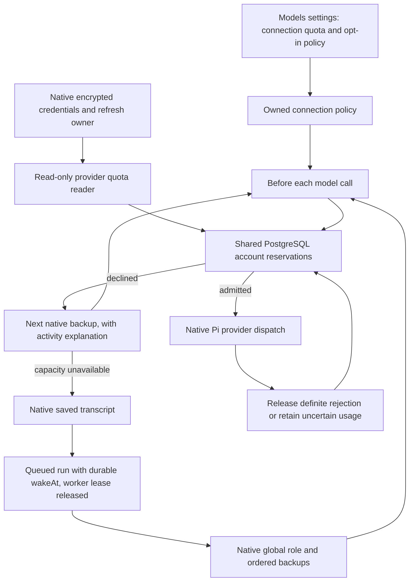

# Subscription quota routing test stack

This fork layers six commits on upstream main. It keeps native model roles,
ordered fallbacks, account authorization, credential refresh and the run queue.
There is no gateway service or second credential owner.

| Layer | Responsibility | Verification |
| --- | --- | --- |
| 1 | Account-bound Codex and Claude quota readers | Offline provider fixtures and owned-credential API checks |
| 2 | Remaining allowance, reset times and refresh in Models settings | Native web browser test, narrow layout and mobile typecheck |
| 3 | Shared PostgreSQL reservations per verified user/provider/account | Concurrent reservations and row-level security |
| 4 | Admission before dispatch, disabled by default | No model request on declined admission, ordinary local errors remain fatal |
| 5 | Skip reason and admitted backup in existing activity stream | Structured runtime events and ordered backup selection |
| 6 | Saved transcript and native queued retry at a model boundary | New runtime resumes after a completed tool, durable wake time and cancellation fencing |



## Try the feature

Use the repository's pinned package manager and Node version. Install normally,
generate Prisma, then start the existing development environment:

```sh
corepack pnpm install --frozen-lockfile
corepack pnpm --filter @rakazo/db exec prisma generate
corepack pnpm dev
```

The native dev launcher prints the URL and isolates this branch's additive
migrations from the shared main database. Ensure `pnpm` subprocesses also use
the pinned package manager, for example with `corepack enable pnpm` in a local
Corepack installation. Do not point a development checkout at production data.

In Models, connect a Codex or Claude subscription through native authorization.
The connected account shows its verified quota windows. Expand Routing, set
Reserve, Request estimate and Uncertainty, then enable Quota-aware routing.
Saving requires a fresh verified observation and an explicit request estimate.
Configure backups through the existing global Main role. Bots inheriting Main
use its order; bot overrides keep their existing meaning.

To exercise a skip, set Reserve high enough that the connected account cannot
admit the estimate. Send a request with a working backup. Activity names the
skipped model and the admitted backup. When every configured account declines
quota admission, the run checkpoints and queues a fresh check within a minute.
Disabling the policy or a fresh usable allowance lets the native queue resume.
Stop still cancels the queued run.

For deterministic browser coverage without real credentials or inference:

```sh
bash scripts/check-quota-stack.sh --full
```

This runs offline tests, package typechecks, disposable PostgreSQL concurrency
and recovery checks, and the native Models browser scenario. Browser quota
screenshots use synthetic account data. No paid inference is required.

## Current limits

Only Codex and Claude have verified quota readers. Other providers, including
OpenCode Go and compatible GOAT connections, retain native reactive fallbacks.
Unknown, stale, unidentified or unsupported quota never becomes invented
headroom. Unknown model-specific provider limits make the reader unavailable.

Provider percentages do not expose an exact token budget. Request estimate and
Uncertainty are explicit percentage estimates. Completed or ambiguous calls
remain reserved until a fresh observation confirms the relevant reset. This is
conservative and can underuse capacity. It is not exact token accounting across
other clients using the same subscription.

Durable continuation covers capacity admission at the main answer's model
boundary. Explicit nested subagent models and compaction are also admitted,
but retain their existing failure behavior rather than serializing independent
nested execution into the answer checkpoint. A genuine provider outage or
account authorization failure retains native error handling.

## Refresh against upstream

From a clean stack checkout:

```sh
bash scripts/rebase-quota-stack.sh
```

This fetches upstream main, creates a new revision branch, rebases the linear
stack, prints a range-diff and runs full verification. The previous branch is
preserved. Conflicts stop at the native rebase for inspection. If upstream
changes dependencies, install under the normal dependency policy before
verification. The helper does not install dependencies, change age guards,
force-push, publish a PR or merge upstream.

Keep the six feature commits separate. Add fixes to the corresponding layer
before publishing a revision. Small hook edits in the native executor, Pi
runtime, settings and RPC router are protected by behavior tests rather than
line-number patches. Once tested, publish the new revision explicitly to the
fork. Upstream submission remains a separate review decision.
